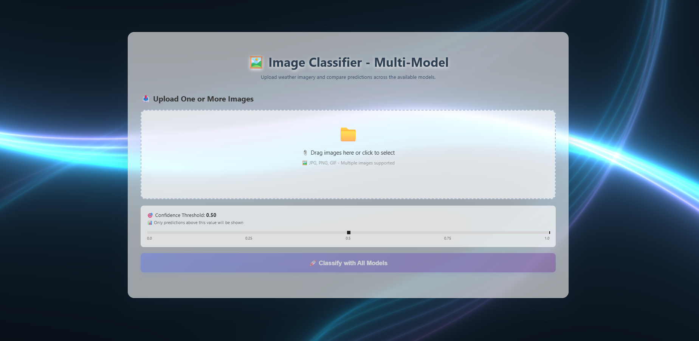
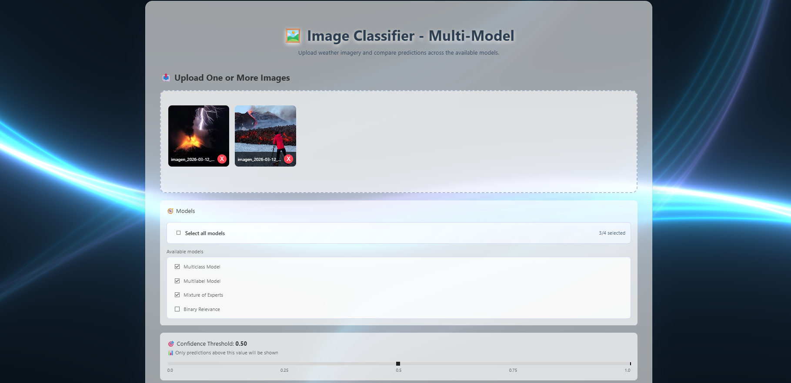
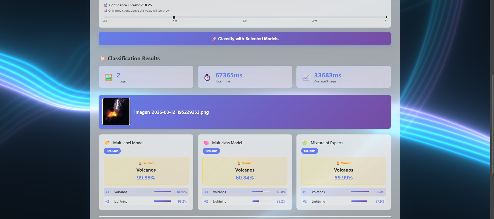
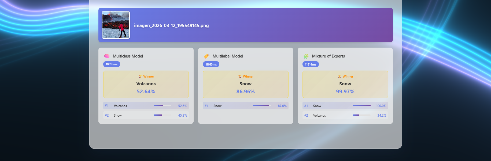

# ComputerVision ML Development and Deploy

A comprehensive computer vision project for weather phenomenon classification using deep learning. This repository demonstrates multiple approaches to multilabel and multiclass image classification, from model development to production deployment.

## 📋 Table of Contents

- [Overview](#overview)
- [Dataset](#dataset)
- [Part 1: Model Development](#part-1-model-development)
  - [Model Approaches](#model-approaches)
  - [Installation](#installation)
  - [Usage](#usage)
  - [Project Structure](#project-structure)
- [Part 2: Deployment](#part-2-deployment)
  - [Architecture](#architecture)
  - [Requirements](#requirements)
  - [Quick Start](#quick-start)
  - [Development Mode](#development-mode-hot-reload)
  - [API](#api)
  - [Screenshots](#screenshots-ui--optional-api)
  - [Run Without Docker](#run-without-docker)

## 🎯 Overview

This project explores different machine learning architectures for classifying weather phenomena in images. The repository is divided into two main parts:

- **Part 1**: Model development, training, and experimentation with multiple approaches
- **Part 2**: Production deployment with Go backend and Vue.js frontend — complete image classification system running 4 models in parallel with SSE streaming

## 📊 Dataset

The primary data source for this project is the [Weather Dataset from Kaggle](https://www.kaggle.com/datasets/jehanbhathena/weather-dataset), which contains images of various weather phenomena.

### Weather Phenomena Classes

The dataset includes 12 distinct weather phenomenon categories:

1. **Dew** - Water droplets formed by condensation
2. **Fog/Smog** - Atmospheric obscurity phenomena
3. **Frost** - Ice crystal formations on surfaces
4. **Glaze** - Smooth ice coating on objects
5. **Hail** - Frozen precipitation pellets
6. **Lightning** - Electrical discharge phenomena
7. **Rain** - Liquid precipitation
8. **Rainbow** - Optical and meteorological phenomenon
9. **Rime** - White ice formation from freezing fog
10. **Sandstorm** - Wind-driven sand particles
11. **Snow** - Frozen precipitation crystals
12. **Volcanoes** - Volcanic activity and eruptions

The dataset has been augmented with additional images collected through web scraping to improve model robustness and handle edge cases.

---

## 🧪 Part 1: Model Development

Part 1 focuses on exploring and comparing different machine learning approaches for weather phenomenon classification. All models use **Transfer Learning** with **EfficientNetB0** as the backbone architecture.

### Model Approaches

#### 1. Binary Relevance for Multilabel Classification
**Notebook**: `model_development_binary_relevance.ipynb`

Implements the Binary Relevance strategy where each class gets its own binary classifier:
- **Architecture**: One expert model per class (12 experts total)
- **Training**: Each expert learns to distinguish its target class from all others
- **Inference**: All experts run in parallel and output independent probabilities
- **Use Case**: True multilabel scenarios where multiple weather phenomena can occur simultaneously (e.g., rain + lightning, volcano + lightning)

**Key Features**:
- Independent binary experts with frozen EfficientNetB0 backbone
- Balanced dataset construction for each binary problem
- Can predict multiple labels simultaneously
- Handles label correlation implicitly

**Advantages**:
- Naturally supports multilabel predictions
- Each expert specializes in one phenomenon
- Easy to add/remove classes

**Disadvantages**:
- More models to train and deploy (12 models)
- Ignores label correlations during training
- Higher computational cost during inference

#### 2. Mixture of Experts (MoE)
**Notebook**: `model_development_MoE.ipynb`

An ensemble approach that combines multiple expert networks:
- **Architecture**: Multiple expert networks with a gating mechanism
- **Training**: Experts specialize in different subsets of the data
- **Inference**: Gating network decides which experts to use for each input
- **Use Case**: When different image characteristics require different expertise

**Key Features**:
- Dynamic expert selection based on input
- Improved model capacity and specialization
- Threshold-based classification (configurable)

#### 3. Single Model Multiclass
**Notebook**: `model_development_single_model_multiclass.ipynb`

Traditional single-label classification approach:
- **Architecture**: EfficientNetB0 + custom dense layers + softmax output
- **Training**: One model learns all classes simultaneously
- **Inference**: Outputs probability distribution over all classes (sum = 1)
- **Use Case**: When each image contains exactly one weather phenomenon

**Key Features**:
- Standard multiclass classification
- Softmax activation ensures mutually exclusive predictions
- Most efficient approach for single-label scenarios

#### 4. Single Model Multilabel
**Notebook**: `model_development_single_model_multilabel.ipynb`

Single model with multilabel capabilities:
- **Architecture**: EfficientNetB0 + custom dense layers + sigmoid output
- **Training**: One model with independent sigmoid activations per class
- **Inference**: Each class gets an independent probability (0-1)
- **Use Case**: Evaluating if a single model can handle multilabel scenarios

**Key Features**:
- Compact alternative to Binary Relevance (1 model vs 12)
- Independent class probabilities
- Faster inference than Binary Relevance
- Explores if shared features help multilabel learning

**Experiment Goal**: Compare single-model multilabel performance against Binary Relevance approach.

### 📦 Installation

#### Prerequisites
- Python 3.8 or higher
- CUDA-compatible GPU (recommended for training)
- 8GB+ RAM

#### Setup

1. Clone the repository:
```bash
git clone https://github.com/Ericson3100/ComputerVision-ML-Development-and-Deploy.git
cd ComputerVision-ML-Development-and-Deploy
```

2. Navigate to Part 1:
```bash
cd Part-1
```

3. Install dependencies:
```bash
pip install -r requirements.txt
```

#### Dependencies

The project requires the following main packages:
- TensorFlow >= 2.13.0 (for deep learning)
- NumPy >= 1.24.0 (for numerical operations)
- Pandas >= 2.0.0 (for data handling)
- Matplotlib >= 3.7.0 (for visualization)
- Seaborn >= 0.12.0 (for statistical visualizations)
- Scikit-learn >= 1.3.0 (for evaluation metrics)
- Pillow >= 10.0.0 (for image processing)
- Jupyter >= 1.0.0 (for notebooks)
- Selenium >= 4.14.0 (for web scraping)

### 🚀 Usage

#### Training Models

1. **Prepare the dataset**: Download the [Weather Dataset](https://www.kaggle.com/datasets/jehanbhathena/weather-dataset) and extract it to `Part-1/dataset/`

2. **Open desired notebook**:
```bash
jupyter notebook
```

3. **Select approach**:
   - For multilabel with multiple experts: Open `model_development_binary_relevance.ipynb`
   - For mixture of experts: Open `model_development_MoE.ipynb`
   - For single-label classification: Open `model_development_single_model_multiclass.ipynb`
   - For single-model multilabel: Open `model_development_single_model_multilabel.ipynb`

4. **Run all cells** to train the model(s)

#### Making Predictions

Sample prediction images are available in `Part-1/predict/` to test the trained models. These include interesting cases like:
- `glaze.jpg` - Ice glaze on surfaces
- `rain-lightning.jpg` - Multiple phenomena in one image
- `rainbow-rain.jpg` - Rainbow with rain
- `volcano_lightning.jpeg` - Volcanic lightning

### 📁 Project Structure

```
Part-1/
├── model_development_binary_relevance.ipynb  # Binary Relevance approach
├── model_development_MoE.ipynb               # Mixture of Experts
├── model_development_single_model_multiclass.ipynb  # Single-label classification
├── model_development_single_model_multilabel.ipynb  # Single-model multilabel
├── requirements.txt                          # Python dependencies
│
├── dataset/                                  # Original dataset (download from Kaggle)
│   ├── dew/
│   ├── fogsmog/
│   ├── frost/
│   ├── glaze/
│   ├── hail/
│   ├── lightning/
│   ├── rain/
│   ├── rainbow/
│   ├── rime/
│   ├── sandstorm/
│   ├── snow/
│   └── volcanos/
│
├── dataset_balanced/                         # Auto-generated balanced dataset
│   └── [same structure as dataset/]
│
├── models/                                   # Trained models
│   ├── binary_relevance/                    # 12 binary expert models
│   │   ├── dew_relevance_expert.keras
│   │   ├── fogsmog_relevance_expert.keras
│   │   └── ... (one per class)
│   ├── MoE/                                 # Mixture of Experts model
│   │   └── moe_model.keras
│   └── unique_model/                        # Single models
│       ├── unique_model_multiclass.keras
│       └── unique_model_multilabel.keras
│
├── predict/                                  # Sample images for testing
│   ├── glaze.jpg
│   ├── rain-lightning.jpg
│   ├── rainbow-rain.jpg
│   └── volcano_lightning.jpeg
│
└── scrapping/                               # Web scraping scripts for data collection
    ├── custom_class.ipynb
    └── [scraped data folders]
```

### 🔬 Model Comparison

| Approach | Models | Training Time | Inference Speed | Multilabel Support | Best For |
|----------|--------|---------------|-----------------|-------------------|----------|
| Binary Relevance | 12 experts | High | Medium | ✅ Native | True multilabel scenarios |
| Mixture of Experts | Multiple + Gating | High | Medium | ✅ Yes | Complex patterns |
| Single Multiclass | 1 model | Low | Fast | ❌ No | Single-label classification |
| Single Multilabel | 1 model | Low | Fast | ✅ Yes | Efficient multilabel |

### 🎓 Technical Details

**Transfer Learning Strategy**:
1. Use pre-trained EfficientNetB0 (ImageNet weights) as feature extractor
2. Freeze base layers initially
3. Add custom classification head
4. Train custom head with frozen base
5. Optional: Fine-tune top layers of base network

**Training Configuration**:
- Image size: 224x224 pixels
- Batch size: 16
- Optimizer: Adam
- Learning rate: 0.001 (with ReduceLROnPlateau)
- Data augmentation: rotation, flip, zoom, shift
- Validation split: 20%

**Callbacks**:
- Early Stopping (patience: 5 epochs)
- Model Checkpoint (save best model)
- Learning Rate Reduction (on plateau)

---

## � Part 2: Deployment

Complete image classification system with a Vue 3 frontend and Go backend.
The application runs **4 models in parallel** for each uploaded image and streams progressive results via **SSE**.

### What the app does

- Upload **one or multiple images** (drag & drop or file picker).
- Parallel execution of 4 models:
  - `multiclass`
  - `multilabel`
  - `mixture_of_experts`
  - `binary_relevance`
- **Confidence threshold** control (0.00 - 1.00).
- Live results per image/model, including top class, top-5, and processing time.
- Global stats: total images, total time, and average per image.

### Architecture

```
┌───────────────────────────────────────────────────────────────┐
│                        Docker Compose                        │
├───────────────────────────────┬───────────────────────────────┤
│ Frontend (Vue 3 + Nginx)      │ Backend (Go + Gorilla Mux)    │
│ - Host port: 3000             │ - Host port: 8080             │
│ - Upload and comparison UI     │ - REST API + SSE stream        │
│ - Calls /api/*                 │ - 4 classification models       │
└───────────────────────────────┴───────────────────────────────┘
```

### Requirements

- Docker Desktop running
- Docker Compose
- Available ports `3000` and `8080`
- If you build locally or mount backend content manually, model files are required under `backend/models/`.
- If you use prebuilt images, local model files are not required.

### Model files (required)

All TensorFlow models must be available inside `backend/models/`.
When building with Docker, the backend image copies `backend/models/` into the container automatically.
The backend is configured with these exact relative paths (from `backend/`):

```text
./models/simple_model_multiclass/unique_model_multiclass
./models/simple_model_multilabel/unique_model_multilabel
./models/MoE/moe_model
./models/binary_relevance/dew_relevance_expert
./models/binary_relevance/fogsmog_relevance_expert
./models/binary_relevance/frost_relevance_expert
./models/binary_relevance/glaze_relevance_expert
./models/binary_relevance/hail_relevance_expert
./models/binary_relevance/lightning_relevance_expert
./models/binary_relevance/rain_relevance_expert
./models/binary_relevance/rainbow_relevance_expert
./models/binary_relevance/rime_relevance_expert
./models/binary_relevance/sandstorm_relevance_expert
./models/binary_relevance/snow_relevance_expert
./models/binary_relevance/volcanos_relevance_expert
```

Expected SavedModel format for each model directory:

```text
<model_directory>/
  saved_model.pb
  fingerprint.pb
  assets/
  variables/
    variables.data-00000-of-00001
    variables.index
```

To export a model from Keras to this format:

```python
import keras

# model = ...
model.export("backend/models/simple_model_multiclass/unique_model_multiclass")
```

For older TensorFlow/Keras versions:

```python
model.save("backend/models/simple_model_multiclass/unique_model_multiclass", save_format="tf")
```

### Quick Start

#### Option 1: Automatic script

**Windows**
```cmd
start.bat
```

**Linux/macOS**
```bash
chmod +x start.sh
./start.sh
```

#### Option 2: Docker Compose (manual)

```bash
docker-compose up --build
```

#### Option 3: Prebuilt images (no local models required)

```bash
docker compose pull
docker compose up -d
```

#### Access URLs

- Frontend: http://localhost:3000
- Backend API: http://localhost:8080
- Health check: http://localhost:8080/api/health
- Swagger UI: http://localhost:8080/swagger
- OpenAPI spec: http://localhost:8080/swagger/doc.yaml

### Development Mode (hot reload)

**Windows**
```cmd
dev.bat
```

**Linux/macOS**
```bash
chmod +x dev.sh
./dev.sh
```

Or with Docker Compose:

```bash
docker-compose -f docker-compose.dev.yml up --build
```

### Makefile commands

```bash
make help
make up
make dev
make logs
make down
make test-backend
make test-frontend
```

### UI workflow

1. Upload one or more images (`JPG/PNG/GIF`, max 100MB per request).
2. Adjust the confidence threshold.
3. Click **Classify with All Models**.
4. Review results per image across the 4 model cards.
5. Compare predictions, confidence scores, and processing times.

### API

#### Swagger

- Swagger UI: http://localhost:8080/swagger
- OpenAPI YAML: http://localhost:8080/swagger/doc.yaml

#### `GET /api/health`
```bash
curl http://localhost:8080/api/health
```

#### `GET /api/models`
Returns metadata for available models (`multiclass`, `multilabel`, `mixture_of_experts`, `binary_relevance`).

```bash
curl http://localhost:8080/api/models
```

#### `POST /api/classify`
Classifies one image with a selected model.

```bash
curl -X POST http://localhost:8080/api/classify \
  -F "image=@image.jpg" \
  -F "model=multiclass"
```

Valid values for `model`: `multiclass`, `multilabel`, `mixture_of_experts`, `binary_relevance`.

#### `POST /api/classify-all`
Classifies one or more images with all 4 models in parallel.

```bash
curl -X POST http://localhost:8080/api/classify-all \
  -F "images=@image1.jpg" \
  -F "images=@image2.jpg" \
  -F "threshold=0.5"
```

#### `POST /api/classify-stream`
Same parallel processing with progressive SSE response streaming (used by the frontend).

```bash
curl -N -X POST http://localhost:8080/api/classify-stream \
  -F "images=@image1.jpg" \
  -F "threshold=0.5"
```

### Screenshots (UI + optional API)

#### 1) Initial UI


#### 2) Multiple images loaded


#### 3) Classification results with threshold behavior




### Run Without Docker

#### Backend
```bash
cd Part-2/backend
go mod download
go run .
```

#### Frontend
```bash
cd Part-2/frontend
npm install
npm run serve
```

